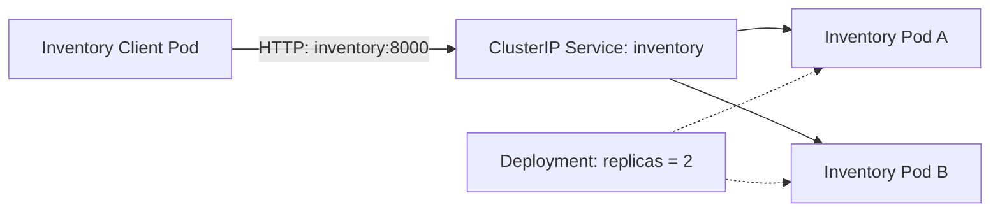
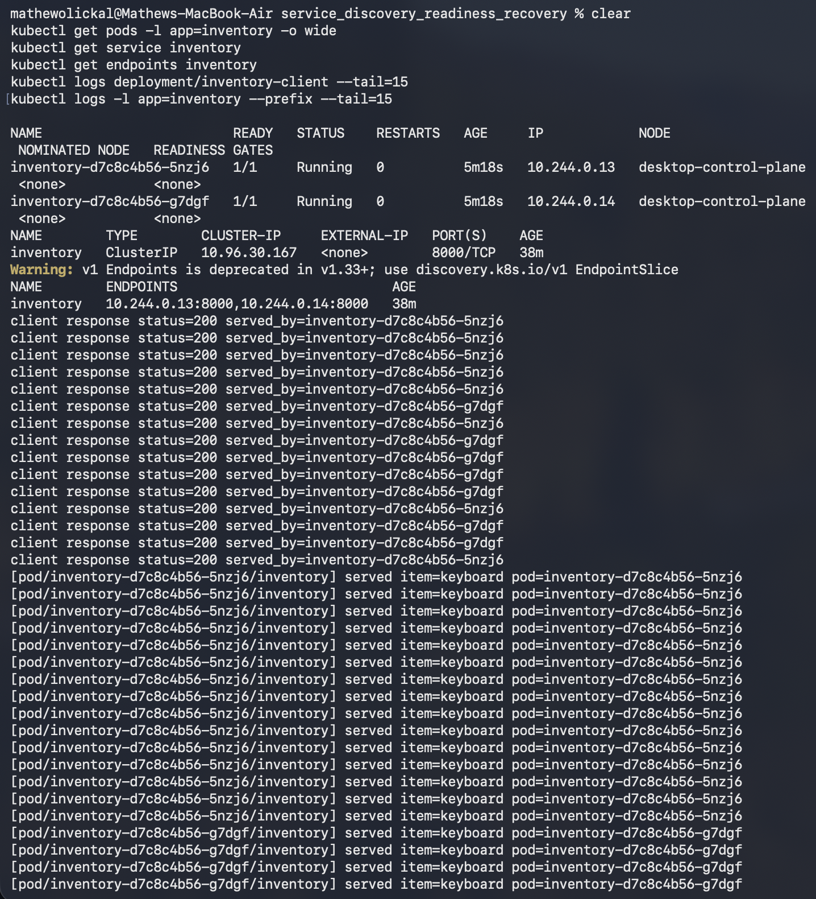
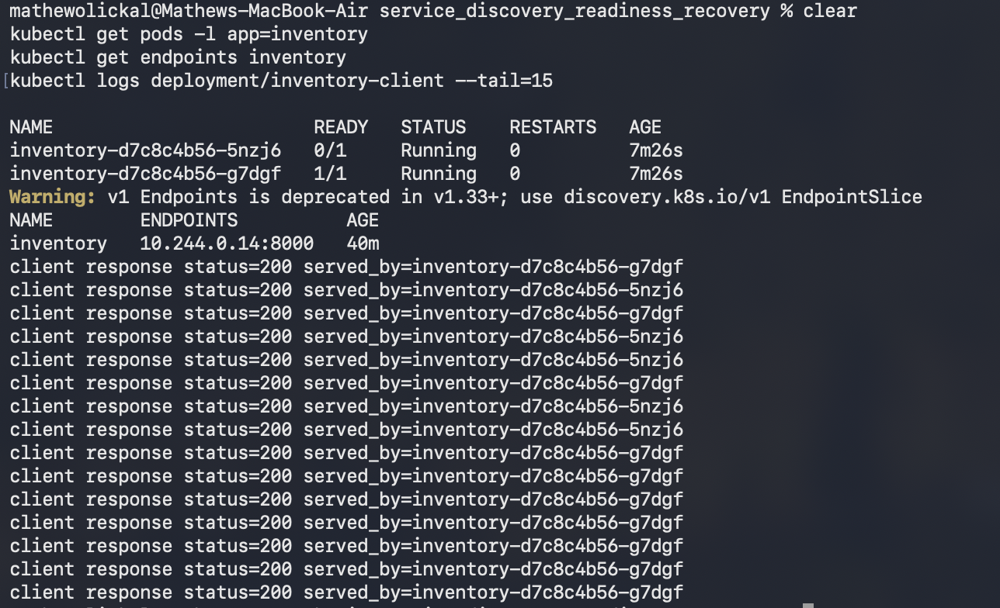
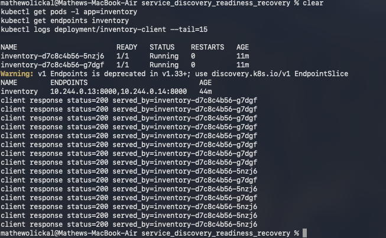
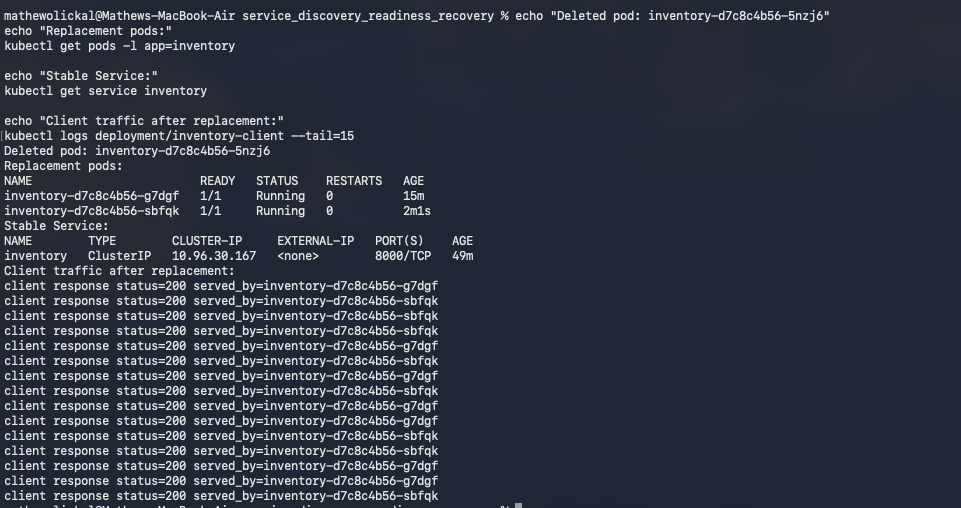

# Module 6: Service Discovery, Readiness & Recovery

This project demonstrates Kubernetes service discovery, readiness probes, and automatic Pod replacement using a Python Inventory Service.

The application consists of two Inventory replicas managed by a Kubernetes Deployment and a separate client that continuously sends requests through the stable Kubernetes Service name `inventory`.

The experiments demonstrate how Kubernetes maintains application availability when a Pod becomes unready or is deleted, without requiring the client to know individual Pod addresses.

## Architecture



### Component responsibilities

| Component | Responsibility |
|---|---|
| Inventory Deployment | Maintains two Inventory replicas and replaces deleted Pods. |
| Inventory Pods | Run the Python Inventory application and expose inventory and health endpoints. |
| Inventory Service | Provides a stable DNS name and routes traffic to eligible Inventory Pods. |
| Inventory Client | Sends HTTP requests using the Service name rather than individual Pod addresses. |
| Readiness Probe | Determines whether an Inventory Pod is eligible to receive normal Service traffic. |
| Liveness Probe | Detects when an application container needs to be restarted. |

The Inventory Deployment maintains two replicas. Each Pod exposes a readiness endpoint at `/ready` and a liveness endpoint at `/healthz`.

The Kubernetes Service named `inventory` provides a stable network identity while the underlying Pods can change. The client communicates through `http://inventory:8000/items/keyboard`.

Each inventory response includes a `served_by` field containing the Pod identity. This allows us to observe which replica processes each request.

## 1. Setup and Deployment

### Prerequisites

This implementation was tested using:

- Docker Desktop with Kubernetes enabled
- Docker Desktop's kind-based Kubernetes cluster
- Python Inventory application packaged in a Docker image
- ARM64 architecture (Apple Silicon)
- `kubectl` configured to communicate with Docker Desktop Kubernetes

The image-loading commands below assume that the Kubernetes node container is named `desktop-control-plane` and uses ARM64.

Other Kubernetes environments, such as Minikube or standalone kind clusters, may require a different image-loading procedure.

### Build the Docker image

From the repository directory:

```bash
docker build -t inventory-k8s:1.0 .
```

### Load the image into Kubernetes

For the Docker Desktop kind-based environment:

```bash
docker image save --platform linux/arm64 \
  --output /tmp/inventory-k8s.tar inventory-k8s:1.0

docker cp /tmp/inventory-k8s.tar \
  desktop-control-plane:/tmp/inventory-k8s.tar

docker exec desktop-control-plane \
  ctr --namespace=k8s.io images import /tmp/inventory-k8s.tar
```

This makes the locally built image available to the Kubernetes node.

### Deploy the application

```bash
kubectl apply -f kubernetes/inventory-deployment.yaml
kubectl apply -f kubernetes/inventory-service.yaml
kubectl apply -f kubernetes/client-deployment.yaml
```

If Pods were created before the image became available, restart the Deployments:

```bash
kubectl rollout restart deployment/inventory deployment/inventory-client
```

Wait for the Deployments:

```bash
kubectl rollout status deployment/inventory
kubectl rollout status deployment/inventory-client
```

### Verify the deployment

```bash
kubectl get deployment,pods,service
kubectl get pods -l app=inventory -o wide
kubectl get endpoints inventory
```

The expected state is:

- Two Inventory Pods are running.
- Both Inventory Pods report `1/1 Ready`.
- The `inventory` Service exists.
- Both ready Inventory Pods appear as Service endpoints.
- The Inventory Client is running independently.

## 2. Service Discovery and Replica Traffic

The Inventory Client sends requests to:

```text
http://inventory:8000/items/keyboard
```

The client uses the Kubernetes Service DNS name instead of an individual Pod IP address.

Follow the client logs:

```bash
kubectl logs -f deployment/inventory-client
```

Example response:

```text
client calling service URL: http://inventory:8000/items/keyboard
client response status=200 served_by=inventory-<pod-suffix>
```

The `served_by` field identifies the Inventory Pod that handled the request.

By observing multiple responses, we can verify that requests reach both Inventory replicas through the same Service name.

### Execution Evidence: Two Inventory Replicas

The following screenshot shows the Inventory replicas, Service endpoints, and requests being processed by different Pod instances.



This demonstrates that the client does not need to know which Inventory Pod handles an individual request.

## 3. Readiness Failure and Recovery

This experiment demonstrates that a Pod can remain running while becoming temporarily ineligible to receive normal traffic.

### Step 1: Select an Inventory Pod

```bash
POD=$(kubectl get pods -l app=inventory \
  -o jsonpath='{.items[0].metadata.name}')

echo "$POD"
```

### Step 2: Simulate readiness failure

The Inventory application uses `/tmp/ready` to control its readiness response.

Remove the file from the selected Pod:

```bash
kubectl exec "$POD" -- rm -f /tmp/ready
```

Inspect the Pod and Service endpoints:

```bash
kubectl get pods -l app=inventory
kubectl describe pod "$POD" | grep -A8 -i readiness
kubectl get endpoints inventory -o wide
```

Observe client traffic:

```bash
kubectl logs -f deployment/inventory-client
```

### Expected behavior

The selected Pod remains in the `Running` phase but changes to `0/1 Ready` after the readiness probe detects the failure.

Kubernetes removes the unready Pod from the Service's ready endpoints.

The other ready Inventory Pod continues serving requests through the unchanged `inventory` Service.

The failed readiness probe does not automatically restart the container because readiness and liveness serve different purposes.

### Execution Evidence: Readiness Failure



The screenshot demonstrates the readiness failure while the application remains running and the other replica continues serving traffic.

### Step 3: Restore readiness

Recreate the readiness file:

```bash
kubectl exec "$POD" -- touch /tmp/ready
```

Verify recovery:

```bash
kubectl get pods -l app=inventory -w
```

After the Pod returns to `1/1 Ready`, stop watching with `Ctrl+C` and inspect the endpoints:

```bash
kubectl get endpoints inventory -o wide
```

Both Inventory Pods should now be eligible to receive traffic.

Verify that the restored Pod receives requests again:

```bash
kubectl logs -f deployment/inventory-client
```

Look for responses containing the restored Pod's identity in the `served_by` field.

### Execution Evidence: Readiness Recovery



The screenshot shows the Pod returning to a ready state and rejoining the Service endpoints.

Restoring readiness allows the Pod to receive normal traffic again without requiring the client to change its Service URL.

## 4. Pod Failure and Automatic Replacement

This experiment demonstrates Kubernetes reconciliation when an Inventory Pod is deleted.

### Step 1: Record the existing Pods

```bash
kubectl get pods -l app=inventory
```

Record the names of the two Inventory Pods before deletion.

### Step 2: Delete an Inventory Pod

```bash
kubectl delete pod "$POD"
```

Watch Kubernetes replace it:

```bash
kubectl get pods -l app=inventory -w
```

The Deployment specifies two replicas, so Kubernetes works to restore the desired replica count after one Pod is deleted.

### Step 3: Verify replacement

After the replacement becomes ready, stop watching with `Ctrl+C` and run:

```bash
kubectl get pods -l app=inventory -o wide
kubectl get service inventory
kubectl get endpoints inventory
```

The replacement Pod should have a different name and identity from the deleted Pod.

However, the Service name remains:

```text
inventory
```

The client continues communicating through the same Service URL.

### Step 4: Verify continued client communication

```bash
kubectl logs -f deployment/inventory-client
```

The client should continue receiving successful responses through the Service.

The `served_by` field can also identify the newly created Pod once it begins receiving requests.

### Execution Evidence: Pod Replacement



The screenshot demonstrates Pod deletion, Kubernetes replacement, and continued communication using the stable Service identity.

## 5. Observations

| Experiment | Expected behavior | Demonstrated behavior |
|---|---|---|
| Initial deployment | Two Inventory replicas are running and ready | Two Inventory Pods deployed |
| Service discovery | Client communicates using the Service name | Client uses `inventory:8000` |
| Replica distribution | Requests reach more than one replica | Different Pod identities appear in responses |
| Readiness failure | Unready Pod stops receiving normal traffic | Remaining ready Pod continues serving |
| Readiness recovery | Restored Pod rejoins eligible endpoints | Pod returns to ready state |
| Pod deletion | Deployment creates a replacement Pod | Replacement receives a new identity |
| Service stability | Service name remains unchanged | Client continues using `inventory` |

These experiments demonstrate the difference between application readiness and Pod failure.

A readiness failure changes traffic eligibility without necessarily restarting the application. Deleting a Pod instead triggers workload reconciliation to restore the Deployment's desired replica count.

In both situations, the Kubernetes Service provides a stable network abstraction that hides changes in the underlying Pods.

## 6. Cleanup

Remove the deployed resources:

```bash
kubectl delete -f kubernetes/client-deployment.yaml
kubectl delete -f kubernetes/inventory-service.yaml
kubectl delete -f kubernetes/inventory-deployment.yaml
```

Verify cleanup:

```bash
kubectl get deployment,pods,service
```

## 7. Reflection

A stable Kubernetes Service name allows clients to communicate with an application without depending on individual Pod names or IP addresses. Since Pods are temporary and may be replaced or rescheduled, their identities can change during normal operation and failure recovery. Kubernetes updates the Service's eligible endpoints as Pods become ready, unready, or are replaced, allowing traffic to reach available replicas. This separation between service identity and individual Pod instances improves resilience and eliminates the need for clients to update their configuration whenever a Pod changes.
