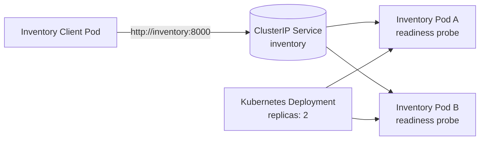

# Module 6: Service Discovery, Readiness & Recovery

This project deploys an Inventory Service with two Kubernetes replicas and a client that calls the service through the stable Kubernetes Service name `inventory`.

## Architecture



The Deployment maintains two Inventory Pods and replaces failed Pods. The `inventory` ClusterIP Service provides stable DNS and sends requests only to ready Pods. The client uses `http://inventory:8000`, never a Pod IP or Pod name. Each response and log includes the serving Pod identity so traffic distribution and replacement can be observed.

## Setup and deployment

This lab targets Docker Desktop Kubernetes. Enable Kubernetes in Docker Desktop settings before starting.

From this project directory:

```bash
docker build -t inventory-k8s:1.0 .

# Docker Desktop kind clusters need the local image loaded into the node.
docker image save --platform linux/arm64 --output /tmp/inventory-k8s.tar inventory-k8s:1.0
docker cp /tmp/inventory-k8s.tar desktop-control-plane:/tmp/inventory-k8s.tar
docker exec desktop-control-plane ctr --namespace=k8s.io images import /tmp/inventory-k8s.tar

kubectl apply -f kubernetes/inventory-deployment.yaml
kubectl apply -f kubernetes/inventory-service.yaml
kubectl apply -f kubernetes/client-deployment.yaml
```

After loading the image into the node, restart any Pods that were created while the image was unavailable:

```bash
kubectl rollout restart deployment/inventory deployment/inventory-client
```

Check the resources:

```bash
kubectl get deployment,pods,service
kubectl get pods -l app=inventory -o wide
kubectl get endpoints inventory
```

Follow the client logs:

```bash
kubectl logs -f deployment/inventory-client
```

The client calls the Service DNS name and prints responses such as:

```text
client calling service URL: http://inventory:8000/items/keyboard
client response status=200 served_by=inventory-<pod-suffix>
```

## Evidence screenshots

Take screenshots of terminal output and save them in `screenshots/`:

- `replicas-and-traffic.png`: two Running Inventory Pods plus client or Inventory logs showing both Pod identities serving requests.
- `readiness-failure.png`: one Pod still Running but `0/1 Ready`, with traffic continuing through the other Pod.
- `readiness-recovery.png`: the restored Pod returns to `1/1 Ready` and the Service endpoints include it again.
- `pod-replacement.png`: before/after Pod lists showing a new Pod name after deletion while Service `inventory` remains unchanged.


## Readiness failure and recovery

Choose an Inventory Pod:

```bash
POD=$(kubectl get pods -l app=inventory -o jsonpath='{.items[0].metadata.name}')
echo "$POD"
```

Make that Pod fail readiness while leaving its process running:

```bash
kubectl exec "$POD" -- rm -f /tmp/ready
kubectl get pods -l app=inventory
kubectl describe pod "$POD" | grep -A8 -i readiness
kubectl get endpoints inventory -o wide
kubectl logs -f deployment/inventory-client
```

The Pod should remain `Running` but become `0/1 Ready`; its endpoint is removed while the other ready Pod continues serving requests.

Restore readiness:

```bash
kubectl exec "$POD" -- touch /tmp/ready
kubectl get pods -l app=inventory -w
kubectl get endpoints inventory -o wide
```

The Pod should return to `1/1 Ready` and be added back to the Service endpoints.

## Pod deletion and recovery

```bash
kubectl get pods -l app=inventory
kubectl delete pod "$POD"
kubectl get pods -l app=inventory -w
kubectl get service inventory
kubectl logs -f deployment/inventory-client
```

The Deployment creates a replacement with a different name. The Service remains named `inventory`, and the client continues using the same URL while Kubernetes routes requests to the available replica.

## Cleanup

```bash
kubectl delete -f kubernetes/client-deployment.yaml
kubectl delete -f kubernetes/inventory-service.yaml
kubectl delete -f kubernetes/inventory-deployment.yaml
```

## Reflection

A stable Service name gives clients a consistent endpoint even when the Pods behind it are recreated or rescheduled. Pods are temporary and their names and IP addresses can change during normal recovery. Kubernetes updates the Service endpoints to contain only healthy, ready Pods, so clients do not need to discover or track individual Pod identities. This separation lets the application recover from Pod failure without requiring client configuration changes.
